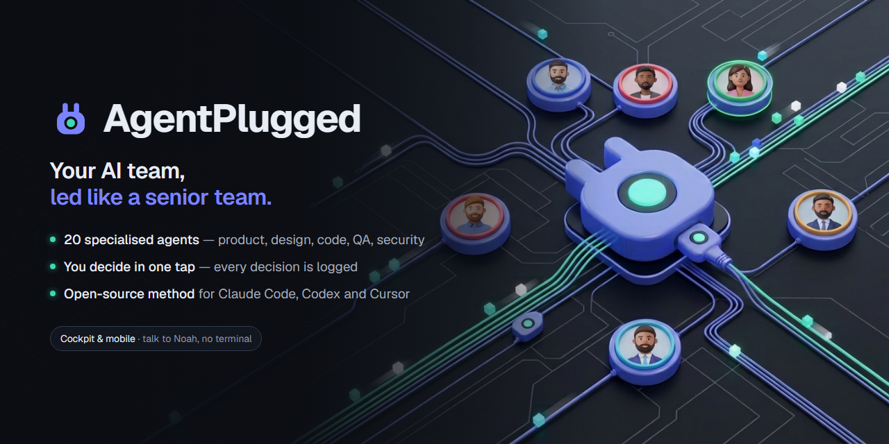

<p align="center"></p>

# AgentPlugged

AgentPlugged is a method and an engine for running a team of AI agents on your product.

The **method** is a set of agents, skills and templates: each agent has one role and owns its
deliverables (brief, PRD, architecture, stories, code, reviews, runbook...). Noah, the main
assistant, is the creator's right hand: you talk to him in plain language, he hands each request
to the agent or skill that owns it, reports back, and presents the decisions one at a time.

The **engine** installs the method in your repository, makes the agents callable from your AI
tool, and keeps the state of the work (decisions, checkpoints, costs, results) in an
append-only journal inside your Git repository. No account, no server.

## Install

Node.js 24 or later is required (Windows, macOS and Linux). The keys stay in the system keychain:
on Linux, that is the Secret Service (GNOME Keyring, KWallet or KeePassXC), which must be running
and unlocked.

```sh
npx agentplugged init      # install the method in .agentplugged/ and choose the product profile
npx agentplugged sync      # generate the files each AI tool reads (skills, agents, AGENTS.md...)
```

`init` never overwrites your `AGENTS.md`, `CLAUDE.md` or `GEMINI.md`: it adds a pointer to the
method once. Run it again to refresh the method; your documents, stories, settings and
`overrides/` are kept. `npx agentplugged --help` lists every command and option.

## Supported AI tools

- Claude Code
- Codex
- Antigravity CLI
- Cursor

`sync` generates, for each tool, the files it reads and declares the engine's MCP server in the
tool's project configuration. The full documentation of the commands is in
[`apps/cli/README.md`](apps/cli/README.md), and the team of agents in
[`method/README.md`](method/README.md).

## What is in this repository

| Folder | Content |
| --- | --- |
| [`apps/cli`](apps/cli) | The `agentplugged` command (npm package `agentplugged`). |
| [`apps/mcp`](apps/mcp) | The MCP server the agents report their status, progress and results through. |
| [`packages/`](packages) | The libraries of the engine: `core`, `protocol`, `crypto`, `i18n`, `adapters-git`, `adapters-tools`. |
| [`method/`](method) | The agents, skills and `models.yaml` that `init` installs. |
| [`tooling/`](tooling) | The checks on the code: import boundaries, the test of the published package, and the install trials (see below). |

## Build and test

This is a pnpm workspace (pnpm 12.8.1, pinned by `packageManager`; Node.js 24 or later).

```sh
pnpm install --frozen-lockfile
pnpm typecheck
pnpm lint
pnpm build
pnpm exec turbo run test --concurrency=2
pnpm smoke     # packs the CLI, installs it in a new folder and runs it
```

## Install trials

The installation is tried on every change, before a release, and again on the published version. The [`Install trials`](.github/workflows/install-trials.yml)
workflow installs the package in a new folder on Windows, macOS and Linux, under Node.js 24 and the
latest Node.js, as a normal user and as an administrator, and types `init --yes`, `doctor`, `sync`
and `next` into the usual terminals (PowerShell, cmd, Git Bash, bash, zsh, sh). It also plays imperfect
machines: no GitHub CLI, no connection, no Git identity, Docker stopped, a long path with spaces and
accents, a proxy with a password, a machine that lost its network after the installation, and checks
that each case gets the right message and the right repair. It runs on every change to the package,
on every `v*` tag (against the published version, `npx agentplugged@<version>`) and every Monday.

On your own machine:

```sh
pnpm build
pnpm trials              # this machine, in a folder of its own; then Linux (WSL) and Windows Sandbox if they are there
pnpm trials sandbox      # a clean, disposable Windows (Windows Sandbox)
pnpm trials linux        # a Linux distribution of WSL
```

Something does not work for you? `npx agentplugged doctor --report` prints a report to attach to
your issue: your system, the versions and the result of every check, with no account name, personal
path, token or product content (the list of what it removes is at its end).

## License

AgentPlugged has two licenses, one for each part:

- **The engine** (`apps/cli`, `apps/mcp`, `packages/`, `tooling/`) is under the
  [Functional Source License, Version 1.1, MIT Future License](apps/cli/LICENSE) (FSL-1.1-MIT).
  You can use it, read it and modify it, but not use it for a competing product or service. Each
  version becomes MIT two years after its publication.
- **The method** (`method/`) is under the [MIT license](method/LICENSE).

[`LICENSE`](LICENSE) at the root of the repository explains the split. Copyright 2026 Innovel
Studio SASU.

## Contributing

Issues and pull requests are welcome on [GitHub](https://github.com/AgentPlugged/agentplugged).
Before opening a pull request, run the commands of "Build and test" above: the CI runs the same
ones on Linux and Windows. For a larger change, open an issue first so that it can be discussed.
