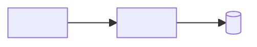

# Architecture of <product>

<!-- Guidance: the `dependencies` of the header list, by ecosystem, the packages and the tools of
the chosen services the product is built on (`npm: [react, supabase]`, `pypi: [Django]`): the
engine reads them once the creator approved the architecture, to let the installations it plans go
through as the creator chose (a validation for each, or none and shown in the activity). Only what
the product is built on, never a package you might want later; an installation outside this list,
or from another source than the official registry, is always validated. Act on each comment of this template, then delete it. Replace every <placeholder>.
Remove the sections that do not apply, except Deferred and Open questions. Use the ids the PRD and
the UX specification give themselves in `links`. Write in the creator's language; keep the
identifiers and the labels Binds, Prevents and Rule as they are. -->

## Context and constraints

<!-- In a few lines: what the product does, for whom, and the constraints that shape the design
(budget, deadline, hosting, compliance, team skills, existing code). Cite requirements by id. -->

## Paradigm

<!-- Name the paradigm (layered, hexagonal, modular monolith, event-driven…) and map its parts to
folders or packages. -->

## Boundaries and dependencies

<!-- The units, what each one owns, and which may depend on which. The diagram is a rule. -->

## Decisions

<!-- One heading per decision: the next free number, never renumbered nor reused. A reversed
decision stays here, retired in place: `### AD-n — (retired) <title>`. -->

### AD-1 — <decision>

- **Binds:** <requirements (EF-n, ENF-n), units or areas it governs, or `all`>
- **Prevents:** <the divergence it rules out>
- **Rule:** <what every builder does, checkable in a diff>

## Conventions

<!-- Defaults where builders working apart would drift. Keep only the rows that matter. -->

| Concern | Convention |
| --- | --- |
| Naming (files, modules, interfaces, events) | <convention> |
| Identifiers, dates, money, errors | <convention> |
| Configuration and secrets | <convention> |
| Logging and errors | <convention> |

## Stack

<!-- Every technology the document names. A version is checked (source and date) or marked
`to verify`, never presented as checked from memory. -->

| Technology | Version | Checked | Licence |
| --- | --- | --- | --- |
| <language, framework, store, library, host> | <version> | <source, date> or `to verify` | <licence> |

## Data and ownership

<!-- The main entities, which unit owns and writes each one, and who reads it. Draw the
relations when they help. -->

| Entity | Owned and written by | Read by |
| --- | --- | --- |
| <entity> | <unit> | <units> |

## Deployment and environments

<!-- Where it runs, the environments, how a change reaches production, and the external
services it relies on. -->

## Deferred

<!-- What is deliberately not decided yet, each with why it can wait. -->

- <item>: <why it can wait>

## Open questions

<!-- What only the creator or another agent can answer, and every version still `to verify`. -->

- <question>
